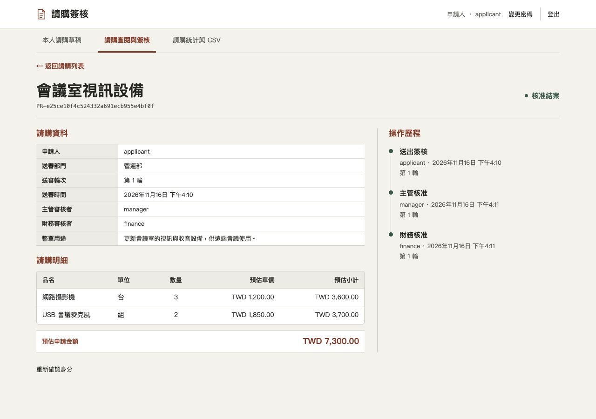

# 請購簽核系統

一套在本機運行的企業請購系統。申請人建立草稿並送審，主管與財務依序簽核，各角色依權限查看請購明細、操作歷程與統計。



*實際系統中的「會議室視訊設備」示範單。申請人可在同一頁核對 TWD 7,300.00 的預估申請金額與兩關核准紀錄。*

## 主要功能

- **請購與簽核**支援草稿、送審及主管、財務依序核准。任一關駁回即結案。首關決定前可撤回修改，以原單號重送，每輪保留送審快照與操作歷程。
- **角色與組織管理**支援維護部門、業務帳號、角色及預設審核人。部門與業務帳號可單筆或批次停用，並可在編輯畫面重新啟用，歷程會保留。審核人失去資格時保留原關卡，由管理員填寫原因並改派未完成的關卡。
- **統計與 CSV**依最近送審日期、送審部門及目前狀態篩選，在帳號可見範圍內統計件數與新臺幣預估申請金額，並匯出同一範圍的資料。
- **帳號與本機維護**提供登入、登出、變更密碼、管理員本機復原與展示資料重設。新建或重設密碼的業務帳號須先變更臨時密碼。

## 技術與工程決策

| 層面 | 技術 |
| --- | --- |
| 前端 | React、TypeScript、Vite |
| 後端與身分驗證 | ASP.NET Core（.NET 10）、ASP.NET Core Identity |
| 資料存取 | EF Core 10、Npgsql、PostgreSQL 18 |
| 本機環境 | Docker Compose，ASP.NET Core 同源提供前端與 API |
| 測試 | xUnit 與 PostgreSQL 整合測試、Playwright 瀏覽器測試、HTTP 負載與 CSV 效能測試 |

簽核寫入在取得 PostgreSQL 交易鎖後重新檢查版本、角色與指派，並在同一筆交易保存狀態、版本及操作歷程。測試讓兩個真實 HTTP 請求等待同一把鎖，再核對只有一個決定生效。另一案例在提交時注入故障，核對原關卡、版本、快照與歷程都保留。[簽核決定](backend/RequisitionApprovalService.cs#L208) · [交易鎖與角色檢查](backend/RequisitionApprovalService.cs#L347) · [重疊請求測試](tests/RequisitionApprovalTransactionTests.cs#L20) · [提交失敗回滾測試](tests/RequisitionApprovalTransactionTests.cs#L201) · [交易設計](docs/backend.md#安全及一致性) · [整合測試覆蓋](docs/testing.md#覆蓋方式)

## 本機啟動

已驗證 macOS ARM64。需要 Docker 與 Docker Compose，以及可用的 `127.0.0.1:5080`。在專案根目錄執行下列命令。

```sh
docker compose -p procurement-approval up --build -d
```

瀏覽器開啟 `http://127.0.0.1:5080`。首次初始化後，用本機編輯器查看 `.local/initial-accounts.json` 的隨機初始密碼。示範帳號為 `admin`（管理員）、`applicant`（申請人）、`manager`（主管）及 `finance`（財務）。若曾復原管理員或重設展示，請查看對應命令顯示的憑證檔。初始密碼檔保留生成時的密碼。

網站以本機 HTTP 提供展示，資料庫留在 Compose 內部網路。資料 volume 與 `.local/keys/` 一起保留，才能在重啟後維持已保存資料與仍有效的登入。[啟動診斷、停止與重啟、管理員復原、展示重設](docs/local-demo.md)

## 手動驗證

1. 用 `admin` 登入，在「組織管理」的「部門管理」按「新增」進入表單。建立部門後回到部門清單。切換到「業務帳號管理」，在 `applicant` 那列按「編輯」，設定該部門及預設主管 `manager`、財務 `finance` 後儲存。回到業務帳號清單後，再開啟同一列核對部門和兩位人選。
2. 用 `applicant` 登入，在「本人請購草稿」新增草稿，填寫主旨、整單用途與一筆明細，例如網路攝影機、單位「台」、數量 `3`、預估單價 `1200`。保存後到「請購查閱與簽核」，依主旨與單號開啟請購，再按「送出簽核」。應看見「主管待審」、總額 TWD 3,600.00，及第 1 輪的送審紀錄。
3. 用 `manager` 登入，開啟同一單並按「核准」。應轉為「財務待審」，歷程新增主管核准。接著用 `finance` 開啟同一單並按「核准」，應顯示「核准結案」。
4. 用 `applicant` 重新查看該單，核對總額、原送審內容和三筆操作歷程。在「請購統計與 CSV」選擇送審部門及「核准結案」，套用條件後下載 CSV，應能用單號在符合條件的明細列核對同一筆請購。

遇到操作結果未確認時，依畫面提示重新確認身分或讀取目前資料，再決定下一步。改密碼結果未確認時可先用新密碼嘗試登入。[前端操作與身分恢復](docs/frontend.md)

### 選測批次停用與重新啟用

1. 用 `admin` 在「業務帳號管理」新增兩個專用測試帳號。勾選這兩列，按「批次停用」後先取消，確認兩列仍勾選且狀態仍為「啟用」。
2. 再按「批次停用」並確認。讀回後，兩列應顯示「停用」，原有部門和角色應保留。按其中一列的「編輯」，將「帳號狀態」改為「啟用」並儲存，確認該列已恢復啟用。

單筆停用、密碼重設與改派的完整驗證步驟見測試文件。[帳號、密碼與改派測試](docs/testing.md#7-驗證帳號密碼與改派)

## 其他操作與自動化驗證

- [測試與驗證](docs/testing.md) 包含撤回重送、駁回、有限改派、統計與 CSV 的操作和預期結果。
- [HTTP 與資料庫測試](docs/testing.md#http-與資料庫) 和 [Playwright 瀏覽器測試](docs/testing.md#前端與瀏覽器) 分別在隔離的 Compose 環境執行。
- 2026-11-06 ARM64 曾通過指定 30 req/s HTTP 負載及獨立 10,000 筆 CSV 基準，詳見[歷史實測](docs/testing.md#2026-11-06-arm64-實測)
- 2026-11-16 ARM64 的兩次 HTTP Load 均因派送延遲超過 33.333 ms 而未通過，最大延遲分別為 48.083 與 39.600 ms。每輪 9,000 筆正式 HTTP 請求全數成功，預熱與正式量測合計各有 2,160 筆寫入完成對帳，六項 p95 均達標。其他平台與更高容量尚待量測。這些是既有記錄，本次未重跑。詳見[基準設定、指令與測量方式](docs/testing.md#指定-http-負載與獨立-csv-匯出)
- [前端開發](docs/frontend.md) 與 [後端及 API](docs/backend.md) 提供程式入口、資料契約及固定工具鏈。
